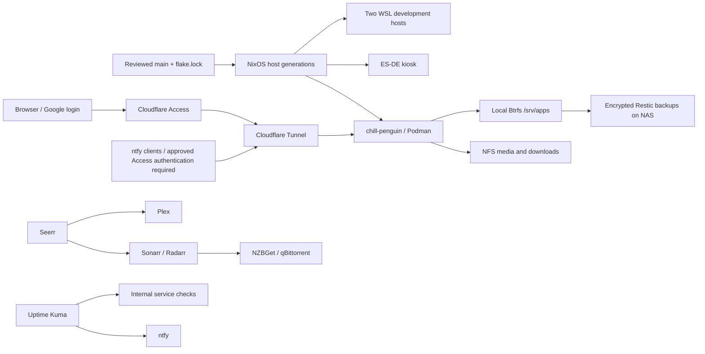

# Fleet operations and modernization

The 3.7.0 configuration was prepared from the September 2026 audit. Repository
validation is separate from native builds, activation, and live acceptance.

## How the fleet works

`flake.nix` constructs four NixOS hosts using shared role modules and Home
Manager. `flake.lock` pins the coordinated nixpkgs, Home Manager, hardware,
Apple Silicon, WSL, index, and secrets inputs. `chill-penguin` runs the
self-hosted inventory; the two WSL hosts run development tools; Boomer runs the
ES-DE kiosk. Secrets are age-encrypted provider/service bundles, decrypted by
host keys and projected under `/run/ghostship-secrets`.



Containers share `ghostship_net`; no new host ports are published. Plex keeps
its existing host exposure. qBittorrent shares Gluetun's VPN namespace. NZBGet
uses direct networking at `http://nzbget:5001`; the old Gluetun namespace
compatibility proxy is retired because the tunnel now targets NZBGet directly.
Network setup remains active after success to serve shared startup
dependencies. Both agent containers keep their own lifecycle and soft network
ordering so refreshing that setup unit cannot stop their work.
Media/download files live on the NAS, while app databases and settings
live locally. The backup repository covers local service state, not a second
copy of the bulk media library.

## Audit findings and changes

Apple Silicon support remains pinned to the compatible revision. Newer upstream
support requires `/boot/vendorfw/firmware.cpio`, rebuilt using the Asahi installer
from macOS; this server currently has `/boot/asahi/all_firmware.tar.gz`. Schedule
that firmware maintenance separately before advancing the hardware input. The
verified live bootloader is systemd-boot with an uncompressed ARM64 Image.

chill-penguin explicitly retains its running `dbus` implementation. The updated
nixpkgs default is `broker`; changing a running system bus requires a separate
reboot window. Keep that change outside live fleet updates so active agents can
continue running and the switch-inhibitor checks remain enabled.

| Finding | Change / remaining acceptance |
| --- | --- |
| Shell quoting reached Podman as literal characters | Separate shell-safe `.env` and raw `.env.container` projections; tested round trips |
| Missing values could silently blank critical settings | Required-secret writes for core arr/database config; atomic replacement preserves original files on failure |
| Activation mixed persistent config writes with service lifecycle | Generate app configuration in `preStart`, after runtime secret projection |
| Network, NAS, and database startup dependencies were inconsistent | Explicit dependencies and NAS mount checks; native health readiness for long-running apps |
| Floating MariaDB engines could migrate before a recovery point | Pin the audited live digests; reviewed engine changes and logical exports |
| No managed recovery or freshness gate | Nightly encrypted backups, checks, retention, restore command, and recent-backup requirement before container updates |
| Retirement could destroy state or affect active development | Quarantine inactive allowlisted paths; preserve active artifacts and Codex |
| No fleet CI or coordinated dependency updates | Evaluate all host derivations, test configuration and failure handling, lint workflows/scripts, scan source for secrets; weekly draft update PRs |
| README described retired apps and manual kiosk startup as current | Correct declared inventory and kiosk behavior |
| Input refresh exposed renamed SSH options / ragenix incompatibility | Use current Home Manager option names with the same policy and nixpkgs ragenix CLI |

No SSH authorization policy change or general Cloudflare policy audit is included.
T3 Code is the primary agent. OpenChamber, Synara, and the ChatGPT/Codex
workstation are retired and quarantined by the shared cleanup sweep.

## Added services

| Service | Internal origin | Public hostname | Purpose and authentication |
| --- | --- | --- | --- |
| Uptime Kuma 2 | `http://uptime-kuma:3001` | `uptime.ghostship.io` | Per-container Podman health heartbeats, internal HTTP/TCP checks, and backup/update heartbeats; Cloudflare Access protects the public hostname and Kuma login is disabled behind it |
| ntfy | `http://ntfy:8080` | `ntfy.ghostship.io` | Operations notifications; Cloudflare Access plus native ntfy authentication |
| Seerr | `http://seerr:5055` | `requests.ghostship.io` | Plex requests routed to existing Sonarr/Radarr profiles and roots; existing Google Access policy plus Plex login |

Monitoring provisioning creates missing `Ghostship ...` entries from the same
registry. A host timer reports each declared container's running and health
state every five minutes; HTTP target URLs follow the registry and existing
notification and interval choices are preserved. Independently added monitors
remain untouched. HTTP checks distinguish successful responses
from redirects; pyLoad uses its direct public `/robots.txt` endpoint because its
favicon route redirects. The provisioning client permits a bounded 256-packet
login burst for existing monitor histories, with a regression covering a
populated fleet. Database/download services without a reliable public HTTP
probe use TCP checks. A five-minute local heartbeat reports stale backup
(30 hours) or update (36 hours) success markers. Missing heartbeat delivery is
also detected by Kuma. Same-host monitoring cannot deliver an alert during a
complete host, power, or tunnel outage; an independent external check remains a
useful later addition.

ntfy denies anonymous access and signup. `publisher` can write only to the
`security`, `operations` and `informational` topics; `android` can read only
those topics; `the owner` administers the instance. Open `secret-edit monitoring` privately to retrieve credentials:
`KUMA_PASSWORD` is the initial Kuma and ntfy administrator password;
`NTFY_READER_PASSWORD` is the Android subscriber password. In the Android ntfy
app, the configured server is `https://ntfy.ghostship.io`, user `android`, and topic
`operations`. The old browser-login bypass was revoked on 2026-10-18. Native
Android delivery may be unavailable until an Access-compatible method is approved;
do not restore a bypass for compatibility. No iOS relay or WARP dependency is configured. A manual
`ghostship-notify --topic informational --source test --title 'Ghostship notification test'` checks delivery after rollout; run as root.

`ghostship-newsletter-health.timer` checks the canonical newsletter checkout every
ten minutes as user 3000 inside `t3code`, through its pinned Nix environment.
Install newsletter 0.5.18 or later first: the command is
`ghostship-am-monitor-status --runtime-only --json --fail-on-unhealthy`.
Newsletter code owns due times, artifact validation and the Gmail delivery ledger.
A failed or unavailable monitor opens one alert episode in `operations` and queues
the stable `newsletter-runtime` incident through `ghostship-notify`; the coordinator
reuses that incident's T3 thread with its existing daily launch limit. The monitor
persists a distinct event ID for each episode before handing it off, then calls
`ghostship-notify --incident-only --incident-id ID` separately from ntfy publishing.
Exit zero from this operation acknowledges a spool file and directory fsync, not
T3 completion. The same ID produces the same coordinator event key after a lost
acknowledgement, even if its previous spool file was consumed. Spool and ntfy
failures retry independently; a pending handoff is retained even if runtime health
recovers. Observed recovery closes the episode even while ntfy is unavailable, so
a relapse gets a fresh persisted incident ID. One pending resolution is retained
across flaps and delivered before a current firing notification, so ntfy's shared
dedupe key cannot suppress that firing. Undelivered incidents use a stable ID
prefix and sequence range instead of a growing episode list; existing episode IDs
are adopted unchanged. Pending handoffs drain one per observation, including healthy
observations, without discarding episodes during an extended spool outage.
Episode state uses file fsync, atomic
replacement and directory fsync; this is local persistence, not a guarantee
against disk loss or a claim of exactly-once remote effects. This host job never
collects, prepares, repairs or sends mail. Its ledger evidence confirms Gmail
acceptance/reconciliation, not recipient receipt. Inspect with
`journalctl -u ghostship-newsletter-health`; stop/start the timer to pause/resume,
or start its service for a manual check. State lives in
`/var/lib/ghostship-newsletter-health/state.json`.

### Notification coverage

`modules/self-hosted/notify-coverage.nix` attaches `ghostship-failure@` to
every `ghostship-*` and `podman-*` service and to a named list of other custom
units, so a new unit of either prefix gets a failure path without further
declaration. A failure publishes to `operations` at priority 4 with the unit's
description, result and exit status, deduplicated per unit for an hour. Backup
jobs also publish their restic summary lines to `informational` at priority 2
through `ghostship-success@`; the summary quotes only restic summary lines, never
other journal output. Evaluation fails when a covered unit loses its failure path,
or when the module names a unit that no longer exists or an exemption without
a reason.

| Units | Notification path |
| --- | --- |
| `ghostship-backup-{backup,check,prune,sample}` | Failure to operations; success summary to informational |
| `ghostship-*` (security, AppArmor, flow, Cloudflare, Seerr, bridges, brokers, skills, inference, provisioning, storage) | Failure to operations |
| `podman-*` containers, `podman-auto-update`, `podman-prune` | Failure to operations once systemd stops restarting; Uptime Kuma heartbeats also alert operations |
| `ghostship-storage-check` (daily) | Failure to operations when the root filesystem is read-only or any Btrfs device error counter is nonzero |
| `nixos-upgrade`, `t3code-deploy-when-idle`, `t3code-nix-store-gc`, `tdarr-staged-guard`, `tdarr-language-policy`, `pyload-restart-failed`, `qbittorrent-auto-resume`, `romm-recovery`, `gluetun-pia-selector`, `gluetun-network-monitor`, `homepage-podman-broker`, `agent-desktop-mcp`, `agent-desktop-ssh`, `flaresolverr-egress`, `init-*-net`, `chill-penguin-retired-artifact-cleanup` | Failure to operations |
| `ghostship-synology-health` (every 10 minutes) | NAS disk health, RAID, temperature, fan, power and volume-usage findings to operations; a failed poll to operations as well |
| `ghostship-security-check`, GitHub coordinator, Cloudflare alerts | Publish their own findings to security or operations as well |

Exemptions, with their reasons:

- `ghostship-failure@` and `ghostship-success@` are the notifiers themselves.
- `ghostship-monitoring-heartbeats` is watched by Uptime Kuma, which alerts
  operations when its five-minute pushes stop.
- Upstream NixOS units (`nix-gc`, `logrotate`, `fstrim`, systemd and network
  daemons) are not custom scripts and stay out of scope.
- SMART on chill-penguin: the internal Apple NVMe has no SMART source verified
  on this host; the Btrfs device error counters in `ghostship-storage-check`
  stand in. NAS disk health comes from `ghostship-synology-health`.
- armored-armadillo, launch-octopus and boomer-kuwanger have no publisher:
  ntfy is reachable only on chill-penguin's `ghostship_net`.
- A `podman-ntfy` failure cannot publish through ntfy itself; it stays in the
  journal and Uptime Kuma's dashboard.

Seerr provisioning authenticates using the existing Plex token, selects the
existing `Optimal` quality profile (or an unambiguous sole profile), and
requires `/tv` and `/movies` roots already present in Sonarr/Radarr. It fails
rather than choosing among ambiguous alternatives. Ordinary users receive
REQUEST permission only, without auto-approval. Library setup supports both the
released query-based API and the newer POST/PUT API. Legacy queries include any
enabled library IDs because omitting them disables selections; the parameter is
omitted only for an intentionally empty selection, since empty values are rejected.
New Plex users require explicit import. After successful first-run setup, the marker
`/srv/apps/seerr/.ghostship-provisioned` preserves later settings. Verify a
request as an ordinary user remains pending until an administrator approves it.

The new credentials are encrypted in the service source bundles. Do not store
runtime env files, setup cookies, push tokens, or plaintext exports in Git.

## One service declaration for Cloudflare and dashboards

Each container module declares a `ghostship.apps.<container>` entry. That is
now the common source for public hostnames, internal origins, Homepage widgets,
Muximux navigation, and HTTP monitoring targets. For example:

```nix
ghostship.apps.sonarr = {
  name = "Sonarr";
  group = "Automation";
  hostname = "sonarr.ghostship.io";
  origin = "http://sonarr:8989";
  healthPath = "/ping";
  icon = "sh-sonarr";
  widget = { type = "sonarr"; key = "env:SONARR_API_KEY"; };
  muximux = { icon = "muximux-sonarr"; color = "#35c5f4"; };
};
```

Both dashboards generate their links from `hostname`, and widget URLs default
to `origin`. RomM, Grimmory, PyLoad, and Uptime Kuma retain explicit Muximux
proxy routes. Internal-only helpers omit `hostname` and `origin`, so they receive no
public DNS/tunnel route or Muximux link. They still receive Homepage entries so
their container status is visible. Dashboard names must be unique, every
registry entry must refer to a declared container, and every declared container
must have a registry entry. Changes are rendered at dashboard startup; the
generated manifest changes their unit scripts, causing NixOS to restart the
affected dashboards on a switch.

Uptime Kuma keeps its same-origin iframe protection on the app itself. The
Muximux host proxy removes that header only for the `uptime.ghostship.io` route
and sets a `frame-ancestors` policy that allows only the protected Muximux origin
and the service itself. Keep the public route behind Cloudflare Access.

The renderer tracks its previous names under `/var/lib/ghostship-dashboards`.
Renames/removals delete previously managed entries while preserving unrelated
links, Calendar, shared settings, and unknown per-entry fields. Registry-owned
fields and widgets are authoritative; edit their module to make changes stick.
Adding another public container needs one app declaration, not three separate
lists. Keep its Homepage secrets projection current when adding widget keys.

Homepage container status uses the restricted Unix socket broker in
`modules/self-hosted/homepage.nix`. It permits container lists, health filters,
and one-shot statistics. Container inspection, logs, filesystem archives,
execution, and lifecycle operations are denied. Homepage mounts the broker
directory read-only and has no host Podman socket or Podman group membership.

FlareSolverr retains its unauthenticated internal API. Its fixed IPv4/MAC and
`flaresolverr-egress` service deny new connections to private peers and the
host, except Podman's DNS resolver. Established replies to internal API callers
and public-site egress remain allowed. The bridge rules cover traffic between
containers as well as routed traffic. Verify the rules with
`python3 tests/check_flaresolverr_egress.py modules/self-hosted/flaresolverr-egress.nft`
as root with `ip` and `nft` available; the test uses isolated network namespaces.

The legacy Muximux runtime receives an atomic settings writer at startup. It
publishes the INI and PHP access guard together; the old in-place header rewrite
could corrupt settings during concurrent requests. Both native and Kuma health
checks use `/favicon.ico`, since `/` can fetch GitHub branches and save settings.

`ghostship-cloudflare-sync.service` reads that manifest and reconciles the
existing remote-managed tunnel and proxied CNAME records at activation/boot and
every six hours. It does not create or replace the tunnel itself. From the
server's root shell:

```bash
ghostship-cloudflare-sync             # show plan; no Cloudflare writes
ghostship-cloudflare-sync --apply     # reconcile immediately
```

Only declared exact hostnames are adopted. Unknown tunnel rules, global tunnel
settings, DNS records, and external Synology/SSH routes remain intact. Existing
origin-request settings are preserved. Conflicting DNS record types or duplicate
managed tunnel rules cause a failure instead of guessing. Before the first
rollout, remove only the shadowed legacy `codex-web:8214` rule for
`codex.ghostship.io`, preserving the first, live `codex:8214` rule and a
private snapshot of the original tunnel configuration. Codex then joins the
same registry without changing its effective public route.

Managed DNS records carry a Nix ownership comment. Previous managed names are
recorded under `/var/lib/ghostship-cloudflare`; removals delete only records
with that marker pointing to this tunnel. The ownership union is recorded before
writes so partial runs can converge on retry. Remote state snapshots are saved
privately under its `history` directory before mutations. These directories are
included in backups; losing the ownership manifest can leave retired records
behind and requires inspecting the saved history. Unrelated manual records are
never automatically deleted. Synchronization uses a local lock and checks for
concurrent tunnel changes before writing; Cloudflare does not provide an atomic
transaction across Access, tunnel configuration, and DNS.

Browser services must already be covered by the existing Google Access policy.
The reconciler validates that coverage and refuses unexpected bypass policies;
it does not rewrite shared wildcard or identity rules. ntfy's former native-auth
bypass was revoked on 2026-10-18 and its specific Access application now requires
the approved Google identity. The reconciler never creates bypass applications.
The one approved exception is `hooks.ghostship.io` (the owner 2026-10-19): a
path-scoped Access application for exactly `/github` and `/cloudflare` whose only
policy is bypass-everyone, recorded in the registry as `cloudflareBypassPaths`
with `cloudflareBypassApproval`. The receiver authenticates those requests itself
(GitHub HMAC, Cloudflare webhook secret); any other bypass still fails validation.
All existing and proposed tunnel hostnames, including unmanaged rules and
path-specific overrides, require complete policy evidence and restrictive identity
or explicitly scoped service-token selectors. Unauthenticated OPTIONS bypasses
are rejected too. Tunnel routes must name explicit hostnames: tunnel wildcards
can route deeper names than Access wildcards protect and are rejected.
Direct Internet exposure outside Access requires recorded
explicit user approval and an AppArmor profile; compatibility is not approval.

After rollout, verify unauthenticated browser requests redirect to Google Access,
allowed users reach the apps, and external anonymous ntfy requests reach Access
rather than the origin. Internal ntfy authentication still denies anonymous
reads/publishes. Android notification delivery needs an approved Access-compatible
method; do not restore the old exception as a recovery step. Keep frame
protections; use a separate tab where an application or Access requires it.

The API credential lives in the encrypted `cloudflare` source bundle. Create a
custom token under Cloudflare **My Profile → API Tokens** with Account
**Cloudflare Tunnel: Edit**, Account **Access: Apps and Policies: Edit**, Zone
**DNS: Edit**, and Zone **Zone: Read**, restricted to the hosting account and
`ghostship.io`. Use `secret-edit cloudflare` and change only `API_TOKEN` in
`secrets/files/sources/providers/cloudflare.env.age`. The reconciler consumes a
root-only runtime projection; no credential enters the Nix store, application
projections, or process arguments. Homepage shows Cloudflared container status
instead of receiving this management token for its API widget. Keep the connector's `TUNNEL_TOKEN` unchanged. The replacement token
passed Access, tunnel configuration, and zone read checks; publication waits
for the reviewed host deployment.

## Backups and recovery

From a root shell on `chill-penguin`:

```bash
ghostship-backup backup
ghostship-backup check
ghostship-backup sample
ghostship-backup restore-check
```

The backup command holds a maintenance lock shared with Podman auto-update
and the entire NixOS automatic upgrade,
requires a real NFS mount, and uses the encrypted `backup` secret. It briefly
pauses the active RomM/Grimmory containers, exports both MariaDB engines,
snapshots `/srv` read-only (or the root subvolume when `/srv` is an ordinary
directory in the declared root layout), and resumes the same containers before transferring
the snapshot. Health recovery is disabled during the bounded pause and restored
afterward; no image pull or service restart occurs. Exact image IDs and the
generation manifest are recorded before pausing.

RomM's database root password comes from the encrypted `romm-db-admin` unit.
The database's post-start migration updates every existing root account and
checks that passwordless login fails. It also accepts the new password on
repeated runs, so an interrupted migration can converge. Backups read the
password inside the database container. Restore validation continues to use
an isolated temporary database; it does not change the live engine or data.

Private-source GitHub Actions jobs on pull requests use the `private-source-ci`
environment. Its required reviewer is `owner`; approval releases the
environment-scoped, read-only agent deploy key. Jobs on `main` (pushes, the
weekly input refresh) use `private-source-main`: no reviewer, but only the
`main` branch may deploy to it, so a pull request that edits a workflow still
cannot reach its key. Each environment holds its own read-only agent deploy key.
Repository-level private-source keys must remain absent so another
pull-request workflow cannot bypass the environment gate. Review changes to the
import script and workflow before approving a run.

SQLite databases and WAL files are captured together. Failure handling resumes
containers it paused and restores their health-check settings and removes the temporary Btrfs snapshot.

Restic stores encrypted snapshots under
`/mnt/share/Backups/ghostship/chill-penguin`. Backup selection includes app
state, logical MariaDB exports, image/generation manifests, SSH host keys, and
Apple Silicon firmware. Raw MariaDB directories, T3 Code's nested Docker and Nix
stores, node_modules, and caches are excluded. Nested Btrfs subvolumes are not
recursively included by a parent snapshot; review coverage before adding any
under `/srv/apps`.

Timers run nightly at 23:00 UTC for backups, Sunday 21:00 for repository checks,
monthly on day 1 at 20:00 for a 10% data sample, and Sunday 19:00 for pruning,
with up to ten minutes of jitter. Retention keeps 7 daily, 5 weekly, and 12
monthly snapshots. Failed jobs alert on `operations`; each successful job
posts its restic summary silently to `informational`. An update is deferred if
no successful backup is newer than 30 hours. This gate protects scheduled
Podman updates; operator-triggered rebuilds must run the same backup step.

`restore-check` restores the new services' state and SQL exports into a unique
root-only directory under `/var/lib/ghostship-backup`. It runs SQLite integrity
checks and imports both dumps into disposable MariaDB containers with no
network or live-volume mounts. The disposable volume is initialized normally,
then reopened with grant checks disabled for logical imports. Anonymous volumes
and scratch data are removed after successful probes. This bootstrap/import
sequence passed a native ARM smoke test with fixture databases on chill-penguin;
a production backup restore is still a rollout acceptance step. Failed restore files remain for inspection;
successful checks remove them. Run it after the first backup and periodically,
and before a database engine upgrade. This drill does not prove full service
recovery, identity login, or every application's file coverage.

For actual recovery, stop the affected writers, restore to a separate directory,
and inspect ownership and versions before replacing app paths. Import logical
SQL dumps into a fresh instance of the recorded database image, then start the
matching application image and verify real application operations. Rolling back
a Nix generation or container image alone does not reverse database migrations.
Preserve the previous app directories until that verification succeeds. Keep an
off-host copy of the age editing/recovery key; a NAS backup alone does not cover
loss of both the server and its recovery keys, or site-wide loss.

## Updates and staged rollout

Registry-labeled applications keep native Podman automatic updates with health
readiness and rollback. Database digests require review. Recyclarr stays on
supported major 8.
Nix system updates deploy committed `main` and its lock, with no local input
refresh. The two WSL hosts and `chill-penguin` run `system.autoUpgrade` nightly from GitHub
`main`; `chill-penguin` adds `--impure` so pure evaluation cannot silently drop
its Asahi peripheral firmware. The T3 Code container is never restarted by the
switch; its image change waits for T3 Code to be idle (see `docs/t3code.md`). The weekly workflow proposes a coordinated lock change with a patch
version and changelog, validates before opening a draft PR, and never merges or
switches hosts. PRs created with `GITHUB_TOKEN` do not automatically trigger a
second workflow run; use the update workflow's validation and explicitly run
Fleet checks after review when needed.

1. Merge reviewed changes after CI. Preserve the running T3 Code container.
2. On a WSL canary, build the merged configuration, inspect changes, switch at
   an idle time, and check shells, agent launchers, SSH agent, and NFS. Then
   repeat for the second WSL host. Do not rebuild both concurrently.
3. `chill-penguin` applies merged main automatically overnight. To deploy
   sooner, pull merged main and switch natively with `--impure`.
4. Check failed units, container health, NAS mounts, configuration file modes,
   secret-dependent integrations, and active agent sessions.
5. Verify automatic Cloudflare reconciliation, then validate Google browser login and Android
   notifications. Test Seerr approval and the existing dashboards/media flows.
6. Boomer is intentionally deferred while offline. Its local licensed PICO-8
   archive and Apple-specific firmware cannot be supplied by generic CI.

CI evaluates all host derivations without building the fleet, builds the config
writer, runs regression tests, checks shell/workflow syntax, and scans the source
for secrets. It does not claim native ARM builds, live container startup, secret
decryption on every host, GPU/controller acceptance, or successful restore drills.

An activation must record the system generation. Use `scripts/activate-host`
instead of calling `switch-to-configuration` directly: it sets the system
profile first, switches, and then verifies that the running system and the
system profile name the same store path.

```bash
# From the built checkout in the server's root shell.
nixos-rebuild build --impure --flake .#chill-penguin
scripts/activate-host --toplevel ./result
```

`scripts/activate-host` runs `nix-env -p /nix/var/nix/profiles/system --set
<toplevel>`, then `<toplevel>/bin/switch-to-configuration switch`, then
compares `readlink -f /run/current-system` with `readlink -f
/nix/var/nix/profiles/system`. It exits non-zero when the two differ, so an
activation that did not record the generation is visible instead of silent.
`--verify-only` performs the comparison alone. The
`ghostship-boot-generation-drift` timer compares `/run/current-system` with
`/nix/var/nix/profiles/system` every five minutes; a mismatch that lasts more
than ten minutes reaches operations through `ghostship-notify` with the
`boot-generation-drift` dedupe key, because a reboot would revert to the
profile's generation.

For the first backup only, from the built checkout in the server's root shell
(the source bundle exports the same `RESTIC_PASSWORD` as its projection):

```bash
umask 077
mkdir -p /run/ghostship-secrets
install -d -m0700 /var/lib/ghostship-backup /var/cache/ghostship-backup
nix develop -c age -d -i /etc/ssh/ssh_host_ed25519_key \
  secrets/files/sources/services/backup.env.age \
  > /run/ghostship-secrets/backup.env.new
mv /run/ghostship-secrets/backup.env.new /run/ghostship-secrets/backup.env
./result/sw/bin/ghostship-backup backup
./result/sw/bin/ghostship-backup restore-check
```

Run these sequentially, stopping on any error. Do not activate the new system
until both commands succeed.
The normal secret projection owns this file after activation. If a hard kill
interrupts the backup process, inspect `podman ps` for paused RomM/Grimmory
containers and unpause them; their declarative health settings are restored by
the next normal unit start. Signal/error traps handle ordinary failures.

## Security review decisions

The 2026-10-10 security review retained these operator-approved trust choices:
services remain unauthenticated on the Docker network; developer/agent tools
keep their broad privileges and mutable automatic updates; service secrets
retain the shared apps-account model; Gluetun's HTTP proxy remains available
on the shared network.
These choices leave supply-chain, lateral-access and shared-secret risks
unresolved. CloakBrowser was retired independently during this review; its
findings remain in progress until activation removes the old enabled units. Emulation findings are deferred while Boomer
is offline.

Trusted LAN clients also retain the Plex/qBittorrent login bypass. Gluetun
retains Podman-gateway DNS for internal names, leaving VPN DNS leakage
unresolved. The Armored Armadillo WSL host remains a production-secret
recipient. These were separate operator decisions in the same review.
The operator also retains manually managed mutable passwords, direct Keep
writes through the owner connection, and existing Tdarr scratch storage. Stale
passwords, compromised connection access, and shared-filesystem exhaustion
remain risks. qBittorrent retains indefinite errored-torrent retries, with
resource-exhaustion risk recorded. Synology restricts NFS clients by IP; the trusted-LAN mount is
retained, with server spoofing and unencrypted traffic still possible.

RomM permits five service starts per hour. Its hourly recovery timer starts
only a failed unit whose result is `start-limit-hit`; it never restarts a
running unit or resets rate-limit counters. This bounds retry frequency while
allowing recovery after the window expires.

## Upstream contracts

- [Podman auto-update readiness and rollback](https://docs.podman.io/en/latest/markdown/podman-auto-update.1.html)
- [ntfy configuration, authentication, and ACLs](https://docs.ntfy.sh/config/)
- [Kuma v2 server API](https://github.com/louislam/uptime-kuma/blob/2.0.0/server/server.js)
- [Seerr settings API](https://github.com/seerr-team/seerr/blob/develop/server/routes/settings/index.ts)
- [Cloudflare custom tokens](https://developers.cloudflare.com/fundamentals/api/get-started/create-token/)

## Autonomous work overview (Grafana)

Grafana's provisioned home is `/d/ghostship-autonomous-work`, with direct links to
host, security and SIEM pipeline dashboards and to the separate AI usage
dashboard (`/d/ghostship-ai-usage`, owned and provisioned by the ai-usage
package). All pages share the same link bar and UTC defaults; work/security
default to today, host/pipeline to six hours. The configured `users.home_page`
points to the provisioned overview UID and `dashboards.default_home_dashboard_path`
loads the same JSON as the home fallback. It is an observation surface only;
Cloudflare Access, Viewer access, vmauth query-only routes and UI network isolation
remain the existing boundary. Datasource provisioning uses the existing
restricted `vmauth.env` credential through `$GRAFANA_VMAUTH_PASSWORD`; INI
`$__file{...}` expansion does not apply to datasource provisioning. No secret
values enter the Nix store. There are no dashboard management actions or new
plugins. `ghostship-autonomous-work.timer` runs every minute; its Python collector
reads existing SQLite projections with `mode=ro`, `query_only`, live-WAL support,
one-second query deadlines and 200 rows per source. The systemd sandbox makes the
stores read-only, permits only Unix sockets (the systemd timer inventory), and
limits memory to 128 MiB, CPU to 10% and execution to 30 seconds.

The current JSONL snapshot in `/run/ghostship-autonomous-work` and node textfile
`autonomous-work.prom` are replaced atomically, not appended. Vector sends the
allowlisted snapshot through existing redaction and disk buffering. VictoriaLogs
and VictoriaMetrics own history and retention; there is no new database or cursor.
Counts are bounded snapshot gauges, not incremented event counters. Lists select
the latest observation per durable identity, so polling does not multiply entries.
Source failures omit counts and success timestamps, and emit `source_up=0`; check
coverage, last-success age and snapshot age before interpreting empty tables.
The link bar is built from a fixed page list, so rebuilding a dashboard cannot
append a second copy of a link; exactly one link per page is verified.
The agents table shows `Model`, `Provider`, `Branch`, `State`, `T3 thread` and
`Parent`; the queues table keeps explicit waiting and background jobs.
Current tables expire observations after three minutes. Lists are capped at 200
rows per source, and no panel claims a complete enumeration: a truncated source
is a lower bound and is counted as such. The default timeline is
today in UTC; source history is limited to the preceding 24 hours and 200 rows
per source. Timeline state transitions deduplicate by identity, state and source
change time; current tables select only the latest state.
Every native project is queried, including manual threads and projects without
broker activity; caps are disclosed rather than presented as complete enumeration.

Stock T3 v0.1.0 provides `scheduledTasks.list` and the orchestration shell HTTP
read. Its installed schema was verified against the stock migrations, and the
collector reads all native project, ordinary/manual thread, pending runtime
request, launch workflow, PR artifact, `scheduled_tasks`, run, subagent and
webhook-delivery projections from
`/srv/apps/t3code/home/.t3/userdata/statev2.sqlite`. It also reads coordinator
`events` and `owners` from `/var/lib/ghostship-github/state/github.sqlite`, runtime
job receipts from the T3 home and MCP persistent state, and host systemd timers.
The live MCP job store was verified at
`/srv/apps/ghostship-private-integrations/ghostship/ghostship-agent/runtime/jobs.sqlite`.
Only that path and the fixed shared-backend / relay `.local/state` alternatives
are read during layout transitions; duplicate job IDs retain the newest receipt.
Missing alternatives are never created and homes are not recursively scanned.
It does not read prompts, titles, error/note bodies, arguments, environment,
webhook URLs/bodies/headers, messages or transcripts. Work identifiers are hashed;
validated T3 UUID links and GitHub issue links permit opening source details.
Coordinator incident daily-limit holds are classified from the exact known result
`over daily limit`, without exporting the note. A native active run is recorded
state, not PID liveness; CI status does not establish objective completion.

### Time selection: what each panel means

Every dashboard follows the native Grafana time picker; there are no custom time
buttons, presets or hand-rolled selectors, and navigation links keep the selected
range and filters (`keepTime`/`includeVars`).

| Panel kind | Semantics | Example |
| --- | --- | --- |
| Selected-range history | `stream:=autonomous-work _time:$__range` — the window is the picker, never a literal | work state timeline, webhook fires |
| Current state | last collector snapshot (one-minute poll), explicitly labelled "snapshot", not a range total | next up, attention, in flight, schedules, projects, threads, handoffs |
| UTC-day card | counted on the collector's UTC day and labelled as such, with a pointer to the range view | work today, webhooks today |
| Rolling rate | five-minute rolling average over the selected range, labelled "rolling" | CPU total, CPU per core, container CPU/transmit, load |
| As-of value | instant query at the end of the selected range | host memory/disk stats, quota and status cards |
| Counter increase | only for a cumulative `_total` counter, never a summed rolling gauge | kernel audit records lost (`increase(..._total[10m])`) |

Where the producer only exposes a rolling gauge, no panel claims a range total:
the panel says what it is instead. This is enforced by
`tests/test_siem_dashboard_time_semantics.py`, which also pins the selected-range
panels to `$__range` and requires every `increase()` to name a `_total` counter.

### Provider page: decisions first, exceptions only, units that read

The provider page is ordered for a ten-second read: the review banner, then the
winners grouped by tier, then the decision inputs, then the exceptions, then the
long usage and ranking reference tables. Winners show the tier, provider, model,
value and its source (`measured` or `prior`), quality, capacity as a share and
expiry as a duration, so a free-tier prior value is never read as frontier
intelligence. A provider filter is a native variable, so the selection and the
time range stay in the URL.

`Providers with no fresh reading` is an exception table: every target is
restricted to providers whose source is not ok, not successful, has no success
within fifteen minutes, or has no reading at all. A healthy provider cannot
appear; an empty table means every source is ok and fresh. The rule is covered by
a fixture regression that proves a healthy source is excluded while partial,
stale, failed and missing sources remain visible.

Two coverage gaps are stated instead of implied. Calculation gates have no
series: the producer publishes the formula and weights only, so the calculation
panel shows no gate rows and says so. The compared candidate set (the ranked
rows) is narrower than the provider catalogs; `Compared vs catalog` publishes
both counts and the candidate table stays anchored to the compared set.

Known missing inputs, not faked: white-line pace and per-component benchmark
metrics are not exported by the producer, so no panel queries them; a contract
change on the producer side is needed before they can be shown.

Pending producer contract for the per-quota widgets (schema owned by the ai-usage
producer; not deployed yet, so no panel queries it): `expected_used_ratio =
elapsed / duration`, and `pace_delta_ratio = expected_used − actual_used`, so a
**positive** value is spare budget (under the line) and a negative value is over
budget; the model-level `pace_delta_ratio` keeps the same sign. A seven-day window
with five days left has 28.6 % expected use, so 20 % used reads as +8.6 pp spare,
never as over budget. The widgets will show the used bar with a white expected
line per quota and each reset separately; a per-row marker inside a table is not a
native Grafana feature and will not be implied. Free-tier ranking follows the
provider, not the price: zero-price promotional models (OpenCode Go) are bulk
candidates, while dedicated free-provider integrations prefer their best eligible
capability tier with fallback and cooldown/unknown capacity shown; a higher
complexity tier needs explicit admission and is never inferred from a model suffix
or a zero price.

### Host resources: CPU over all cores and the real memory split

The host page is the primary resource view for the agents and the server:
total CPU utilisation over every core (`100 × (1 − avg(rate(node_cpu_seconds_total{mode="idle"}))`),
per-core utilisation (`100 × (1 − avg by (cpu)(rate(...)))`), and memory as
`total`, `used = total − available` and `available`, all in bytes from the same
exporter. Percent is 0–100 and memory uses IEC bytes, so the panels read the same
way as the host's own tools. `Host writers` counts the exporters reporting
`MemTotal` and `CPUs reporting` counts the distinct idle counter series: on the
live host there is no `instance` or `job` label, one series per cpu and exactly one
`MemTotal` series, so nothing is double counted and a second writer would be
visible instead of silently blended. A stale or empty sample stays unknown; the
sample age is next to the values for exactly that reason.

### Agents: who is running, on which branch, with which model

The overview answers "what is running now" from the native execution projection, not
from titles. One row exists per native thread, ordinary or app-owned child, across
every project:

- state is the current run's recorded state (`running`, `waiting`, `queued`, plus the
  terminal states), with `waiting` when the thread has a pending native request; it
  is a recorded state, never process liveness. The projection stores no
  authoritative active-run binding, so execution authority decides: an executing run
  outranks queued work, queued work outranks terminal history, and a newer queued
  model switch can never hide the run that is actually executing;
- provider and model come from the current run's `modelSelection` (falling back to the
  run's own provider), never from the thread's configured default after a switch;
- branch comes from the thread projection (`payload_json.branch`), not from a title;
- the parent link comes from the subagent projection (`child_thread_id` → parent
  thread), and the row is omitted when no parent is recorded;
- absent fields stay absent, so the table shows them as unknown instead of inventing
  a value.

Active work is enumerated in bounded pages (four pages of 500) so the two-hundred-row
history cap can never hide a running agent. The real active total is published on the
`t3_agents` coverage row, so a collector cap is disclosed instead of silently dropping
agents. Terminal threads are a separate windowed source (`t3_agent_history`, last 24
hours, bounded like every other list). Branch and model are private operational values:
they travel only through the authenticated Grafana and the private VictoriaLogs
datasource, never as Prometheus labels, and no title, prompt, transcript, raw error or
personal value is exported.

The environment id is read from the stock runtime file the server already writes
(`stateDir/environment-id`, under the read-only T3 userdata mount) and accepted only
as a UUID; a missing or malformed file keeps the app deep link. No id is baked into
configuration, and no secret service or network call is involved.

Thread ids are opaque: ordinary threads are UUIDs, app-owned children look like
`thread:delegated-task:command%3Amcp%3A...`, and some rows use `mcp:<uuid>`. The link
uses the coordinator's stock contract (a plain path join of the environment and the
raw id, or the `t3-thread://v1/...` app link when the environment is unknown) and
fails closed on any other shape, so a child link is kept instead of being dropped by
a UUID-only check.

### What the overview reports, and what it refuses to claim

- Schedules keep four separate facts: the enable flag, the next run, the last run
  and the last result. A disabled schedule keeps the outcome of its previous run
  and is listed in the inventory, not in "next up".
- Completion claims are classified, never merged: `model_report` for a provider or
  runtime report about work, `ci` for a CI/check/workflow-run receipt, `review`
  for a submitted review receipt, `pr_closed` for a closed pull request receipt,
  `deployment` for a deployment status receipt and `ci_proof` for the coordinator
  CI proof. The dashboard counts the classes separately and links them from one
  table.
- The coordinator CI proof (`pull_progress`) is read as scalars on the exact
  revision: the outcome, the merge flag, the required check count and the
  failing check count. It proves the configured checks on that revision and
  nothing else. A failing required check wins, and a stale revision is
  invalidated before any evidence read, so the proof fails closed. The table is
  optional: a coordinator without it is an explicit gap, not an empty result.
- The owner state of the coordinator is read only in its compact safe values
  (`incomplete`, `uncertain`, `closed_unverified`). The raw note is never read.
- Objective completion has no source. It is published as an explicit coverage gap,
  never as a zero count of completed objectives.
- The frontier approval and the deployed health of a change have no source in
  this collector. They stay explicit unsupported gaps until such a source
  exists; they are never rendered green.
- A thread state is the current one: an active or queued run wins, otherwise the
  latest executed run by completion time. The highest run ordinal alone can mask
  a run that started and failed later. A recorded active state is not process
  liveness.
- AI provider usage, limits and model rankings belong to the separate ai-usage
  package and dashboard. This collector does not read provider token usage at all
  and publishes `ai_usage` as a gap owned elsewhere, not as a claim about its
  deployment state. The page links to `/d/ghostship-ai-usage` directly.
- Per-source counts are gated on that source being readable and on a fresh
  snapshot. A missing source shows as unknown, not as zero, and a truncated source
  is shown as a lower bound with the truncation count on the same screen.
- "Today" is the UTC day computed at collection time (`event_today`,
  `fired_today`), not a dashboard macro: Grafana expands no `$__from`/`$__to`
  macro for this datasource, and a stale clock would otherwise widen the window.
- ChatGPT Tasks has no local inventory. Only a prior UI observation exists, and
  no count from it is published as a current measurement. External GitHub hook
  subscriptions have an explicit inventory gap and are not inferred from
  receipts; a push fire appears only after an actual subscribed receipt.
- The optional coordinator `automatic_reviews` table is nonfatal when absent
  on older deployments. It preserves queued/requested/native-running/terminal/
  reported/superseded/blocked states; `reported` is a model report, not objective, CI
  or deployment proof. Native PR links and review PR/thread links lead to the exact
  source artifacts; deployment readiness/completion is unknown without source
  evidence. Optional router provenance in coordinator `meta` is selected only from
  known scalar fields under `model-route:%` keys: selected provider, first-choice
  quota/reason, selected/wait state, fallback flag and cooldown expiry. Stale
  cooldowns expire; absent or different schemas show a gap. Optional
  `model-continuation:%` meta selects only state, provider, project/thread IDs,
  update time, acceptance flags and bounded native/executing run counts. Review
  `occupied` is shown as a reserved slot. Neither a reservation nor accepted
  switch/message receipt establishes objective completion; frozen command/text,
  notes and native run payloads are excluded. No raw meta values,
  review tasks, notes or receipts are exported.

### Verification

Re-run the dedicated suite in the repository Nix environment:
`python3 -m unittest discover -s tests -p test_siem_autonomous_work.py`.
Set `GHOSTSHIP_TEST_VLOGS` / `GHOSTSHIP_TEST_VMETRICS` to native store executables
to include the all-dashboard query check: every panel of every page is executed
against disposable VictoriaLogs and VictoriaMetrics instances, every list panel
must return fixture rows, every count panel must count them, and a second poll
must not multiply either list entries or counts. Set `GHOSTSHIP_TEST_GRAFANA` to
the Grafana package root and `GHOSTSHIP_TEST_PROVISIONING` to the realised
provisioning output for the native home, four-dashboard and datasource-auth
regression.

Verified in a disposable Grafana with the provisioned dashboards and fixture
observations: the home opens the overview, the single link bar reaches every page,
the summary panels show real values, and the list panels show real rows with their
label columns (schedules with next/last/result, attention items, in-flight runs,
queued jobs, webhook receipts, CI proofs). The table recipe is the datasource's
documented one: extract the log labels, replace the raw log fields, keep the row
time, then rename the columns. A `fields` pipe must keep `_time` and `_msg`,
otherwise the datasource cannot give the panel a row time or a line.

A headless browser without a font configuration is a trap for this check: Skia
aborts with `SkFontMgr_FontConfigInterface ... Not implemented` and the renderer
dies mid-paint, which shows every list panel as headers with empty rows even
though the data arrived. Set `FONTCONFIG_FILE` to a local fontconfig that points
at a store font directory before taking the screenshot; no network font is
involved. This is an environment fault, not a dashboard or datasource defect: the
same panels render rows once fonts resolve, and the existing `security.json` log
panels behave identically.

Deployment and browser rendering require separate target-host verification.

Existing dashboard checks use read-only VictoriaMetrics/VictoriaLogs queries; no
log bodies leave the host. AppArmor `ALLOWED` learning events and enforced
`DENIED` events are separate. Falco log rows retain `_msg` (without it, the
plugin's log line is empty unless JSON packing is enabled). Firing-alert labels
use an instant Prometheus table result. Zero alerts is gated on fresh watchdog
and node samples plus active vmalert units; empty denial/alert tables can be a
valid zero, while missing collector freshness remains unknown. Grafana 13's
provisioned dashboards are in its unified `resource` table, so an empty legacy
`dashboard` table does not prove provisioning failed. A `fields` pipe must keep
`_time` and `_msg`, otherwise the datasource cannot give the panel a row time or
a line.
